<div align="center">

<h1>🃏 Revio</h1>

<p>
  <a href="https://flutter.dev">
    
  </a>
  <a href="https://dart.dev">
    
  </a>
  <a href="CASE_STUDY.md">
    
  </a>
  <a href="LICENSE">
    
  </a>
  <a href="https://flutter.dev">
    
  </a>
  <a href="https://play.google.com/store/apps/details?id=com.ahmed.revio&hl=en_US">
    
  </a>
<p>

<p><strong>A dark-themed, offline-first Flutter flashcard app with topic management, a searchable library, Study Mode, and Multiple Choice & Smart Typing quizzes powered by a custom 5-tier typo-tolerant answer matcher. Built with Clean Architecture, Cubit state management, Hive CE persistence, and adaptive responsive design across 9 screens and 7 feature modules.</strong><p>


<p align="center">
  <a href="https://play.google.com/store/apps/details?id=com.ahmed.revio&hl=en_US"></a>
  &nbsp;&nbsp;
  <a href="CASE_STUDY.md"></a>
  &nbsp;&nbsp;
  <a href="https://youtu.be/U_NKt3eMoHA"></a>
  &nbsp;&nbsp;
  <a href="https://www.youtube.com/playlist?list=PLb61g0A7n4BA"></a>
</p>


<p>
  <a href="#-case-study">📌 Case Study</a> •
  <a href="#-features">✨ Features</a> •
  <a href="#-screenshots">📷 Screenshots</a> •
  <a href="#-study-mode">📖 Study Mode</a> •
  <a href="#-technical-stack">🔧 Stack</a> •
  <a href="#-architecture">🏗 Architecture</a> •
  <a href="#-getting-started">🚀 Getting Started</a> •
  <a href="#-author">👤 Author</a>
</p>

</div>

---

## 📖 Table of Contents

- [Demo Video](#-demo-video)
- [Overview](#-overview)
- [Case Study](#-case-study)
- [Features](#-features)
- [Study Mode](#-study-mode)
- [Responsive Layout & Adaptability](#-responsive-layout--adaptability)
- [Screenshots](#-screenshots)
- [Technical Stack](#-technical-stack)
- [Architecture](#-architecture)
- [Smart Answer Matching](#-smart-answer-matching)
- [Dependencies](#-dependencies)
- [Getting Started](#-getting-started)
- [Known Limitations](#-known-limitations)
- [Roadmap](#-roadmap)
- [License](#-license)
- [Author](#-author)

---

<div align="center">

## 🎬 Demo Video

<p>
  <a href="https://youtu.be/U_NKt3eMoHA"></a>
  &nbsp;&nbsp;
  <a href="https://www.youtube.com/playlist?list=PLb61g0A7n4BA"></a>
</p>

</div>

---

## 📖 Overview

**Revio** (v2.2.0) is a Flutter flashcard application for active learning and memorization. All cards are stored in a local Hive CE database — everything works fully offline.

**v2.2** ships:
- **Study Mode** — a dedicated self-paced review screen with 3D flip cards and swipe navigation
- **Persistent Quiz History** — results saved to Hive, viewable with average accuracy, per-entry and bulk deletion
- **Per-topic & favorites-only quiz filtering** — choose any combination of topics before every session
- **Upgraded 5-tier answer matcher** — exact, alternative-split, numeric, partial with negation conflict guard, and adaptive Levenshtein fuzzy matching
- **8 built-in topics** with a protected default (*No Topic*), plus unlimited custom topics
- **6-destination navigation drawer** with active-route highlighting and a quick-add button
- **Shared `CategoryFilterHelper` modal** — the same topic/favorites filter UI reused across Library, Study, and Quiz screens
- Fully refined **Midnight Obsidian & Cyber Cyan** Material 3 dark interface

It is a personal portfolio project built to practise Clean Architecture, Cubit/BLoC state management, and local persistence in a real, shippable app.

---

<div align="center">

## 📌 Case Study

> 📑 **Looking for a deep technical engineering breakdown? Check out the complete [Revio Case Study (`CASE_STUDY.md`)](CASE_STUDY.md).**

</div>

Revio was architected and built from scratch to demonstrate production-ready Flutter development, Clean Architecture principles, and algorithmic problem-solving.

### 🔍 Key Engineering Highlights Covered in the Case Study

- **Product Vision & Problem Solving**: Designing a 100% offline-first flashcard system with topic organization, custom quiz modes, and persistent accuracy tracking.
- **Clean Architecture & State Management**: 7 feature modules (`add_new_card`, `cards`, `home`, `quiz`, `review`, `study`, `genres`) powered by 5 Cubits, 21 explicit state classes, and stream-based reactive persistence via `watchCards()`.
- **Custom 5-Tier Typo-Tolerant Answer Matcher**: Algorithmic answer validation (*Exact → Alternative Split → Numeric → Partial with Negation Conflict Guard → Adaptive Levenshtein Fuzzy Matcher*).
- **Critical Architectural Decisions**:
  - **Shared `CategoryFilterHelper`**: Static modal helper eliminating duplicate UI logic across Library, Study, and Quiz.
  - **3D Flip Card State Management**: Dynamic key lifecycle management storing `GlobalKey<FlipCardState>` by card ID to ensure fresh card orientation.
  - **Async Session Guards**: Preventing stale cubit state transitions when users exit mid-quiz via auto-incrementing `_sessionId`.
- **Key Challenges & Retrospective**: Managing stream lifecycles, fine-tuning Levenshtein fuzzy thresholds, and designing responsive layouts across phones and tablets.

<p align="center">
  <a href="CASE_STUDY.md">
    
  </a>
</p>

---

## ✨ Features

### 🏠 Home Dashboard
- Animated stat counters: **Total Cards**, **Favorites**, **Topics** — updated in real time via `watchCards()` stream
- **Study Mode** entry banner (gold-accented) → goes directly to Study screen
- **Recent Quiz** activity banner (shown only when history exists) → links to Quiz History
- Quick-action cards: **Library** (shows live card count), **New Card**
- **Topics wide card** showing total topic count
- **6-destination navigation drawer**: Dashboard · Study Mode · Card Library · Quiz Arena · Quiz History · Topics — with active-route highlighting and a *Add Flashcard* primary button at the bottom
- `v2.2` version badge in the app bar

### 🃏 Flashcards
- **3D flip-card animation** (`flip_card`, 350–400 ms) to reveal the answer; tap to flip in the library
- **Category badge** on every card, with a unique color dot per topic from the category color map
- **Optional hint** shown on the card front with a 💡 amber icon (hidden during quizzes unless toggled)
- **Semantic accessibility labels** on every card face
- **Automatic Arabic RTL/LTR detection** — text direction switches per field based on Unicode range `\u0600–\u06FF`
- In the library: **Favorite toggle**, **Edit** (bottom sheet), **Delete** (confirmation dialog) — all from action icons on the card front
- **Mark as Favorite** toggle also available when creating a new card (CupertinoSwitch)

### 🗂 Library (Manage Library)
- **Full-text search** across question, answer, and hint — animated search bar with focus glow and clear button
- **Filter button** (circle, with active indicator dot) opens the shared `CategoryFilterHelper` modal
- **Active filter banner** below the search bar — shows active topic/favorites filters, one-tap clear
- **"Showing X / Y cards"** live counter + *"Tap a card to edit"* hint
- **Add card** via FAB (top-right) without leaving the library — pre-fills active topic
- **Swipe-to-delete** (end-to-start) with a confirmation dialog
- **Edit card** via bottom sheet — updates stream automatically refreshes the list
- Opens pre-filtered from the home dashboard (by topic chip or favorites shortcut: `__FAVORITES__` route argument)

### 🏷 Topics (Genres)
- **8 built-in topics**: No Topic · General · Science · Math · Language · History · Geography · Technology
- **Create custom topics** via the *Add* dialog — instantly available in all pickers
- **Rename** any non-default topic — all associated cards update automatically
- **Delete** any non-default topic — associated cards move to *No Topic*; count shown in confirmation dialog
- **Swipe-to-delete** on topic list items (protected items block the gesture)
- **"X topics available"** banner + *"Swipe to delete"* hint
- Color-coded category indicators used consistently throughout the entire app

### 🎯 Quiz (Quiz Arena)

**Setup screen (Topic Selection → Mode Selection):**
- **Topic selector card** — opens the shared filter modal; displays active topic selection as text
- **Favorites Only toggle** — `CupertinoSwitch` card; filters quiz to starred cards only
- **Quiz mode cards**: *Multiple Choice* (pick from 4 shuffled options) or *Smart Typing* (type the answer)
- **Summary banner** shows how many cards match the current filter (minimum 3 required to start)
- **Back-press protection** during an active quiz — shows an exit confirmation dialog

**In-progress screen:**
- Animated **progress bar** with correct / wrong live counters and question index
- **FlashCard** shown at the top (question side), sized responsively via `LayoutBuilder`
- **Hint toggle** (`CupertinoIcons.lightbulb`) — shown only if the card has a hint
- **Multiple Choice**: 4 option buttons; immediate color feedback (green correct, red wrong); auto-advances after 1 000 ms
- **Smart Typing**: text field with animated cyan focus border; submit on tap or keyboard action; auto-advances after correct/wrong feedback
- **Skip button** in both modes — skips with a 600 ms delay, increments skipped counter
- **Correct answer banner** (`CorrectAnswerBanner`) shown for 1 000 ms when wrong before advancing

**Results screen:**
- Animated **score ring** (`ScoreRingPainter` CustomPainter, 1800 ms animation with `Interval` easing)
- Animated score percentage counter inside the ring
- Performance badge (*Outstanding Master / Impressive Knowledge / Great Effort / Keep Practicing*)
- Stats card: correct · wrong · skipped · time taken (MM:SS)
- **Play Again** (cyan primary button) → returns `true` to replay
- **Back to Modes** (ghost text button) → returns `false`
- Result automatically saved to `quiz_history_box` on completion

**Quiz History screen:**
- Summary card: total quizzes taken · average accuracy percentage
- Scrollable list of past results — score badge (green ≥ 70 %, cyan otherwise), mode name, date, time taken, correct/wrong counts
- **Delete individual entry** (trash icon) with confirmation dialog
- **Clear All** (app bar trash icon) with confirmation dialog
- Empty state with clock icon when no history exists

### ✍️ Add New Card
- **Topic / Category** chip picker (`GenreChipPicker`) with inline *+ Add topic* button
- **Question (Front)** — required multi-line field, validated
- **Hint** — optional field, `Optional` badge label
- **Answer (Back)** — required multi-line field, validated
- **Mark as Favorite** — `CupertinoSwitch` toggle card
- **Discard protection** — `PopScope` intercepts back navigation if any field has unsaved text; shows confirmation
- Automatic RTL/LTR text direction per field

---

## 📖 Study Mode

A dedicated screen for self-paced flashcard review, built as a standalone feature module:

- **Horizontal swipe navigation** — `GestureDetector.onHorizontalDragEnd` to browse cards; velocity-based direction detection
- **3D flip-card animation** (`flip_card`, 350 ms) — cyan front face, gold back face; each card gets its own `GlobalKey<FlipCardState>` keyed by card ID; flip key is cleared when navigating away so the next visit always shows the front
- **Shared filter modal** — same `CategoryFilterHelper` as Library and Quiz; filter icon in the app bar turns cyan with an indicator dot when a filter is active
- **Active filter banner** — appears below the app bar; one-tap clear resets to *All*
- **Shuffle** — calls `fetchAllCards()` on `GetAllCardsCubit` to re-randomize the Hive-sorted list; resets index and clears all flip keys
- **Progress row** — *Card X of Y* label + animated linear progress bar + shuffle button
- **Navigation row**: *← Previous* · *Next →* (last card becomes *Finish 🎉*) — buttons are `null` (disabled) at boundaries
- **Empty states** — different messages for no-favorites vs. no-topic matches; both show a *Clear Filters* button

---

## 📐 Responsive Layout & Adaptability

Revio is built for mobile, foldable, and tablet form factors:

| Technique | Detail |
|:----------|:-------|
| `LayoutBuilder` + `ConstrainedBox` | Caps content width — 700 dp (quiz/results), 750 dp (study/add card), 800 dp (home/topics), 850 dp (library) |
| `flutter_screenutil` | All sizes in `.sp`, `.w`, `.h`, `.r` — scaled from a 360 × 690 design canvas |
| Adaptive quiz card height | `(constraints.maxHeight * 0.25).clamp(135.0, 200.0)` via `LayoutBuilder` |
| Keyboard-safe scroll | `MediaQuery.viewInsetsOf(context).bottom` added to scroll padding in quiz |
| Bouncing physics everywhere | `BouncingScrollPhysics` on all scroll views |
| Fade route transitions | `FadeTransition` 250 ms forward / 200 ms reverse on every route |

---

<div align="center">

## 📷 Screenshots

</div>

<div align="center">

### 🚀 Launch

| App Icon | Splash Screen |
|:--------:|:-------------:|
| 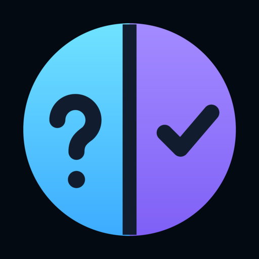 | 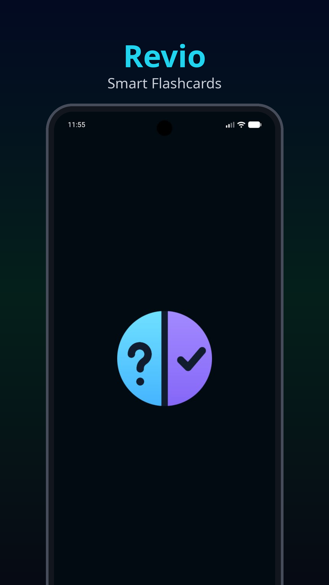 |
| Revio on your home screen | Native dark splash |

### 🏠 Home

| Home Dashboard |
|:--------------:|
| 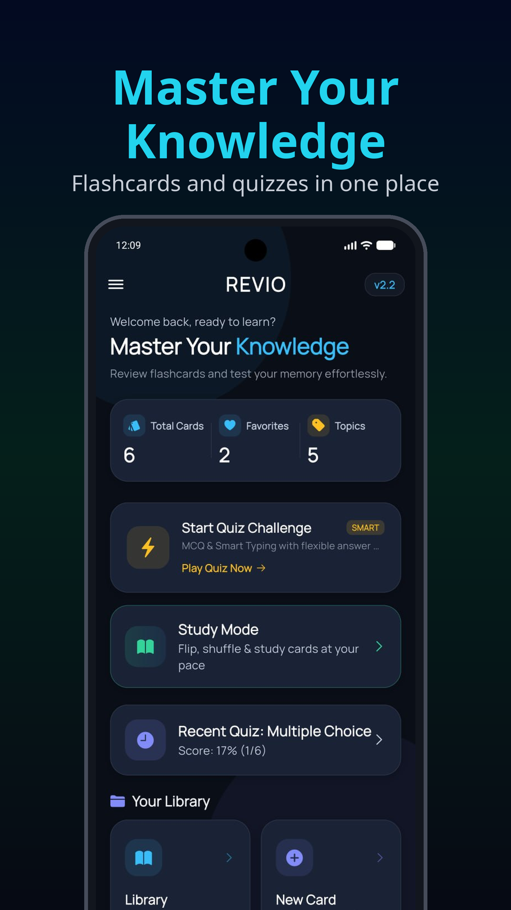 |
| Stats · Study Mode banner · Recent quiz · Quick actions · Nav drawer |

### 📖 Study & Library

| Study Mode | Manage Library | Create Card | Manage Topics |
|:----------:|:--------------:|:-----------:|:-------------:|
| 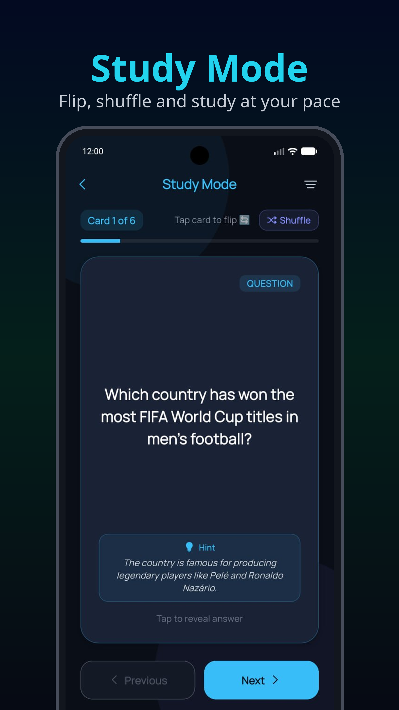 | 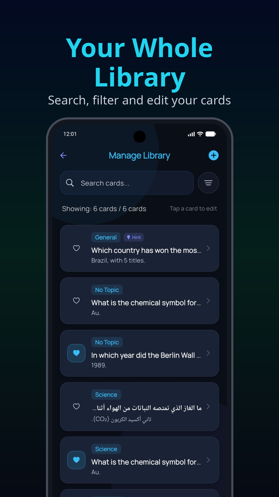 | 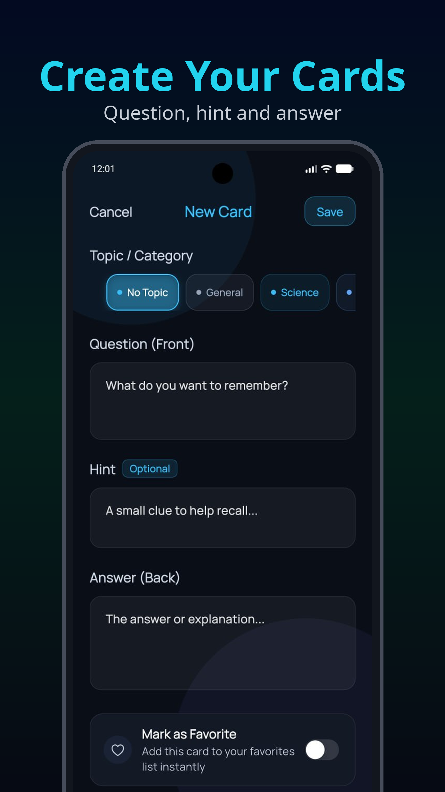 | 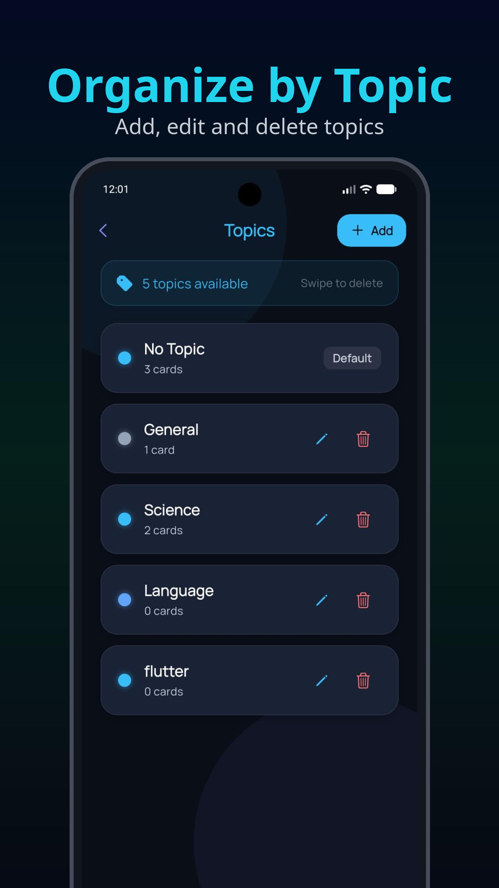 |
| Flip · Swipe · Shuffle · Filter | Search · Filter · Edit · Delete | Topic · Hint · Answer · Favorite | Add · Rename · Delete topics |

### 🎯 Quiz Experience

| Quiz Setup | Multiple Choice | Smart Typing | Results | Quiz History |
|:----------:|:---------------:|:------------:|:-------:|:------------:|
| 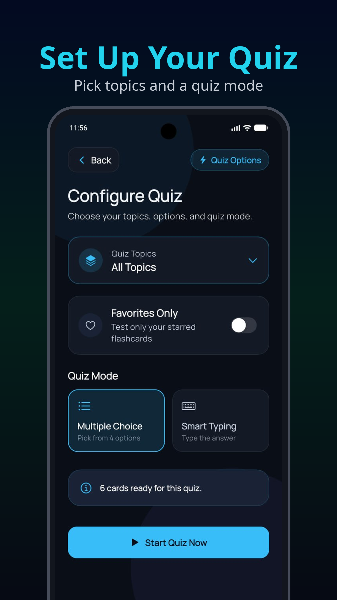 | 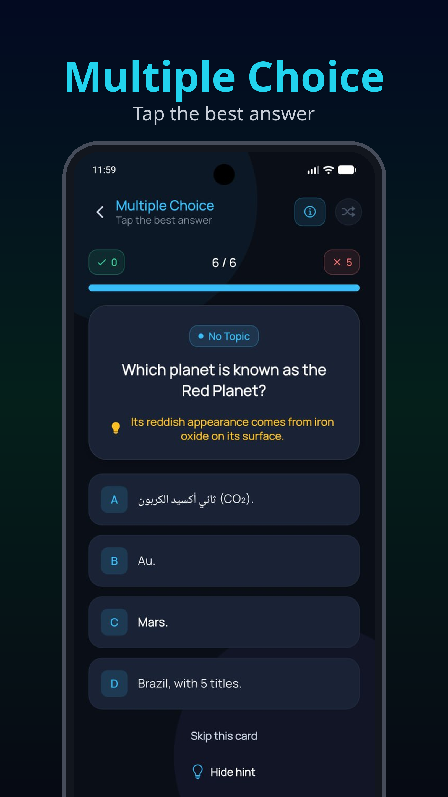 | 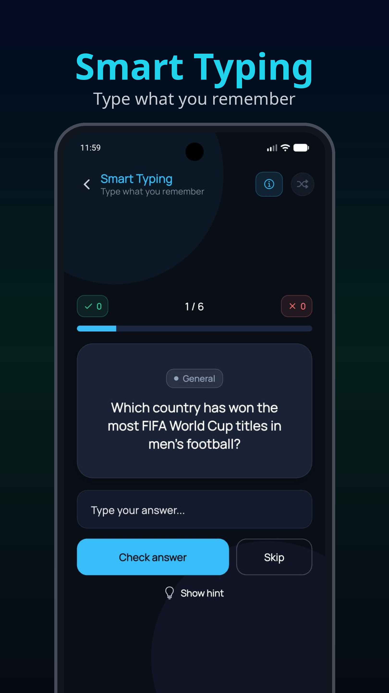 | 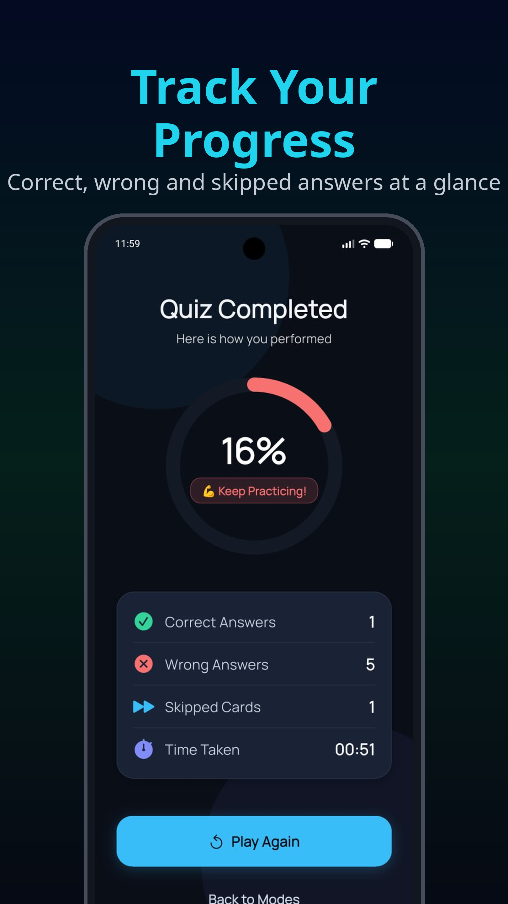 | 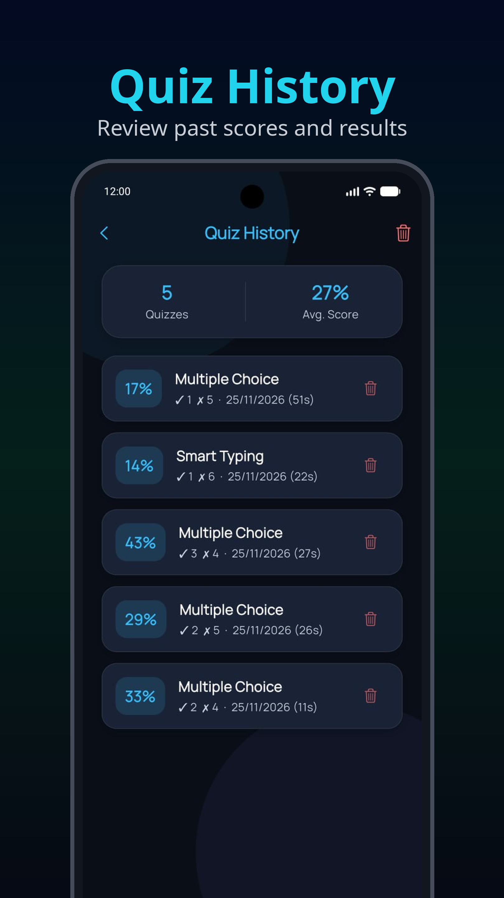 |
| Topic & favorites filter | Real-time color feedback | 5-tier fuzzy matching | Animated score ring | Persistent history & avg score |

> **Note:** Some screenshots use demo data to showcase specific features.

</div>

---

<div align="center">

## 🔧 Technical Stack

</div>

<div align="center">

| Component | Technology | Purpose |
|:---------:|:----------:|:-------:|
| **Framework** | Flutter 3.x | Cross-platform UI (Android & iOS) |
| **Language** | Dart (SDK ^3.14.0) | Core development |
| **State Management** | flutter_bloc ^9.1.1 | Cubit pattern — 5 Cubits, 21 explicit state classes |
| **Local Database** | hive_ce ^2.19.3 | Offline-first storage — 4 Hive boxes |
| **Hive Flutter** | hive_ce_flutter ^2.3.4 | Flutter initialization & box lifecycle |
| **Material UI** | material_ui ^1.11.1 | Material design widgets |
| **Cupertino UI** | cupertino_ui ^1.1.7 | iOS-style widgets & icons |
| **Responsive UI** | flutter_screenutil ^5.9.3 | Pixel-perfect scaling (360 × 690 canvas) |
| **Card Animation** | flip_card ^0.7.0 | 3D flip effect in Library, Study & Quiz |
| **Icons** | cupertino_icons ^2.0.0 | iOS-style icon set |
| **Code Generation** | hive_ce_generator ^1.11.2 + build_runner ^2.15.1 | Hive TypeAdapter generation |
| **Splash Screen** | flutter_native_splash ^2.4.8 | Native dark splash |
| **Launcher Icons** | flutter_launcher_icons ^0.14.4 | App icon generation |
| **Project Rename** | rename ^3.1.0 | Bundle ID and app name management |
| **Design System** | Material 3 Dark Theme | Midnight Obsidian & Cyber Cyan palette |
| **Typography** | Manrope | 27 responsive text styles via screenutil |

</div>

---

<div align="center">

## 🏗 Architecture

</div>

Revio follows **feature-based Clean Architecture** — each feature is a self-contained module with its own `data/`, `logic/`, and `ui/` layers. Shared infrastructure lives in `core/`.

### 📁 Project Structure

```
lib/
├── main.dart                                  # App entry point
│                                              # → Hive.initFlutter()
│                                              # → Hive.registerAdapters() (generated)
│                                              # → opens 4 boxes with per-box error recovery
│                                              # → provides root GetAllCardsCubit (stream-based)
│                                              # → ScreenUtilInit (360×690 canvas)
├── hive_registrar.g.dart                      # Generated TypeAdapter registry
│
├── core/
│   ├── constants/
│   │   ├── app_constants.dart                 # Named routes, 8 built-in topic names, default topic
│   │   └── app_strings.dart                   # UI string constants
│   │
│   ├── helpers/
│   │   ├── answer_matcher.dart                # 5-tier answer matching engine
│   │   │                                      # normalize → exact → alternative-split →
│   │   │                                      # numeric → partial (negation guard) → fuzzy (Levenshtein)
│   │   ├── category_filter_helper.dart        # Shared modal bottom sheet
│   │   │                                      # → topic multi-select chips with per-topic card count
│   │   │                                      # → favorites toggle + count badge
│   │   │                                      # → "All" shortcut, Reset Filters button
│   │   │                                      # → reused in Library, Study, and Quiz
│   │   ├── category_manager.dart              # Topic CRUD over Hive
│   │   │                                      # → getActiveCoreCategories / getCustomCategories
│   │   │                                      # → deleteCategoryAndReassignCards (moves to No Topic)
│   │   ├── routing_extension.dart             # BuildContext.pushNamed / pop / pushAndRemoveUntil
│   │   ├── snackbar_helper.dart               # showSuccess / showError / showInfo
│   │   └── spacing.dart                       # verticalSpacing / horizontalSpacing / sliverVerticalSpacing
│   │
│   ├── routing/
│   │   └── app_router.dart                    # Switch-based route generation
│   │                                          # → FadeTransition (250 ms / 200 ms)
│   │                                          # → scopes BlocProviders per route
│   │
│   ├── theming/
│   │   ├── app_colors.dart                    # 24 color tokens, 7 LinearGradients,
│   │   │                                      # categoryColors map (7 topics → Color)
│   │   ├── app_styles.dart                    # 27 Manrope TextStyle getters (scaled via .sp)
│   │   └── app_themes.dart                    # ThemeData: Material 3 dark, AppBarTheme,
│   │                                          # CardTheme, InputDecorationTheme, DialogTheme,
│   │                                          # SnackBarTheme, ElevatedButtonTheme,
│   │                                          # TextButtonTheme, ChipTheme, DividerTheme
│   │
│   └── widgets/
│       ├── active_filter_banner.dart          # Dismissible active-filter chip banner
│       ├── add_genre_dialog.dart              # "Add Topic" text-input dialog
│       ├── app_background_glow.dart           # Per-screen gradient glow (home/review/quiz/addCard variants)
│       ├── app_buttons.dart                   # Shared button components
│       ├── app_card.dart                      # Glassmorphic card container
│       │                                      # (color, border, radius, padding, onTap, width/height)
│       ├── app_confirm_dialog.dart            # Confirmation dialog (destructive & non-destructive)
│       ├── app_drawer.dart                    # 6-destination NavigationDrawer
│       │                                      # → _DrawerTile (icon, label, subtitle, isSelected)
│       │                                      # → "Add Flashcard" primary button at bottom
│       ├── app_sheet.dart                     # Bottom sheet helper (showModalBottomSheet wrapper)
│       ├── app_text_dialog.dart               # Text-input dialog with validation
│       ├── genre_chip_picker.dart             # Horizontal scrolling topic chip row
│       │                                      # → "+ Add topic" inline chip opens AddGenreDialog
│       └── press_scale_widget.dart            # Tactile press-to-scale GestureDetector wrapper
│
└── features/
    │
    ├── add_new_card/
    │   ├── logic/
    │   │   ├── add_card_cubit.dart            # emitSaveCard → CardsRepo.saveCard
    │   │   └── add_card_state.dart            # Initial / Loading / Success / Error
    │   └── ui/
    │       ├── add_new_card_screen.dart       # Form screen: topic picker, question, hint, answer,
    │       │                                  # favorite toggle, discard PopScope guard
    │       └── widgets/
    │           ├── app_text_form.dart         # Styled TextFormField with optional validator
    │           ├── appbar_body.dart            # App bar + Save button → triggers AddCardCubit
    │           └── card_form_back_scope.dart  # PopScope: checks if any field is non-empty
    │
    ├── cards/                                 # Shared card data layer + reusable card widgets
    │   ├── data/
    │   │   ├── models/
    │   │   │   ├── card_model.dart            # @HiveType(typeId:0), 8 HiveFields
    │   │   │   └── card_model.g.dart          # Generated TypeAdapter
    │   │   └── repo/
    │   │       └── cards_repo.dart            # Singleton; saveCard / updateCard / deleteCard /
    │   │                                      # toggleFavorite / searchCards / getCardsByCategory /
    │   │                                      # getFavoriteCards / watchCards() (async* stream)
    │   ├── logic/
    │   │   ├── get_all_cards_cubit.dart       # Root cubit; holds StreamSubscription to watchCards();
    │   │   │                                  # exposes searchCards / getCardsByCategory / getFavoriteCards
    │   │   └── get_all_cards_state.dart       # Initial / Loading / LoadedSuccess(cards) / Error
    │   └── ui/widgets/
    │       ├── card_action_icon.dart          # Small icon button with tooltip (favorite/edit/delete)
    │       ├── card_face.dart                 # Front or back face; category badge; RTL detection;
    │       │                                  # hint display; action icons in review mode
    │       ├── confirm_message.dart           # Delete confirmation via AppConfirmDialog
    │       └── flash_card.dart               # FlipCard wrapper (card_face front + card_face back)
    │
    ├── home/
    │   └── ui/
    │       ├── home_screen.dart               # CustomScrollView with Slivers; reads QuizHistoryRepo
    │       │                                  # for recent result banner; nav drawer attached
    │       └── widgets/
    │           ├── action_card.dart           # Tappable icon+title+subtitle action card
    │           ├── cards_number_container.dart# Stat row: Total · Favorites · Topics
    │           ├── genres_wide_card.dart      # Topics count card → navigates to Topics screen
    │           ├── hero_quiz_card.dart        # Prominent "Start Quiz Challenge" banner
    │           ├── home_hero_greeting.dart    # Greeting header with app tagline
    │           └── home_stat_item.dart        # Individual animated stat counter widget
    │
    ├── quiz/
    │   ├── data/
    │   │   ├── models/
    │   │   │   └── quiz_result_model.dart     # id, modeName, totalCards, correct/wrong/skipped,
    │   │   │                                  # timeTakenSeconds, timestamp; toMap/fromMap
    │   │   └── repo/
    │   │       └── quiz_history_repo.dart     # Singleton; saveResult / getAllResults (sorted desc) /
    │   │                                      # deleteResult / clearAll; lazy box open with guard
    │   ├── logic/
    │   │   ├── quiz_cubit.dart                # emitShowTopicSelection / emitProceedToModeSelection /
    │   │   │                                  # emitStartQuiz (shuffle + build unique-answer pool) /
    │   │   │                                  # emitSubmitAnswer (MCQ exact / typing 5-tier) /
    │   │   │                                  # emitSkipCard / _moveToNextOrComplete (saves history on done)
    │   │   └── quiz_state.dart                # QuizTopicSelection / QuizModeSelection(selectedCards) /
    │   │                                      # QuizInProgress(cards, index, counts, mode, options…) /
    │   │                                      # QuizCompleted(counts, timeTaken, mode)
    │   └── ui/
    │       ├── quiz_screen.dart               # PopScope back-guard; BlocListener on QuizCompleted →
    │       │                                  # pushes results screen; resets to TopicSelection on return
    │       ├── quiz_history_screen.dart       # Total & avg-accuracy summary card; sorted result list;
    │       │                                  # delete single / clear-all with confirmation
    │       ├── quiz_results_screen.dart       # AnimationController 1800 ms; score ring CustomPainter;
    │       │                                  # stats fade-in; Play Again / Back to Modes buttons
    │       └── widgets/
    │           ├── correct_answer_banner.dart  # Amber banner shown after a wrong answer
    │           ├── quiz_app_bar.dart           # In-quiz app bar: mode label, correct/wrong counts
    │           ├── quiz_back_chip.dart         # Back chip button in setup header
    │           ├── quiz_exit_dialog.dart       # "Exit quiz?" confirmation shown on back press
    │           ├── quiz_favorites_toggle_card.dart # CupertinoSwitch card for favorites-only filter
    │           ├── quiz_in_progress_view.dart  # Quiz body: progress bar, flash card, options/input,
    │           │                               # hint toggle, correct-answer banner
    │           ├── quiz_mode_card.dart         # Selectable mode card (MCQ / Typing)
    │           ├── quiz_options_view.dart      # 4-option MCQ button grid with color feedback
    │           ├── quiz_progress_bar.dart      # Animated LinearProgressIndicator + counters
    │           ├── quiz_result_stat_row.dart   # Single stat row (label + value) in results card
    │           ├── quiz_results_stats_card.dart# Card with correct/wrong/skipped/time stats
    │           ├── quiz_setup_header.dart      # "Quiz Arena" title + back chip
    │           ├── quiz_setup_view.dart        # Full setup screen (topic card, favorites toggle,
    │           │                               # mode cards, summary banner)
    │           ├── quiz_summary_banner.dart    # Card count + "Start Quiz" CTA button
    │           ├── quiz_topic_selector_card.dart # Topic selector display card → opens filter modal
    │           ├── score_ring_painter.dart     # CustomPainter: arc ring, gradient stroke, center hole
    │           └── typing_quiz_input.dart      # Animated TextField + Submit + Skip buttons
    │
    ├── review/
    │   ├── logic/
    │   │   ├── delete_card/
    │   │   │   ├── delete_card_cubit.dart     # emitDeleteCard → CardsRepo.deleteCard
    │   │   │   └── delete_card_state.dart     # Initial / Loading / Success / Error
    │   │   └── edit_card/
    │   │       ├── edit_card_cubit.dart       # emitUpdateCard → CardsRepo.updateCard
    │   │       └── edit_card_state.dart       # Initial / Loading / Success / Error
    │   └── ui/
    │       ├── review_cards_screen.dart       # Library screen: search bar, filter, counter,
    │       │                                  # live list, add-card FAB; opens pre-filtered
    │       │                                  # via initialCategory route argument
    │       └── widgets/
    │           ├── add_card_modal_bottom_sheet.dart  # Add-card form in a bottom sheet
    │           ├── card_search_bar.dart               # Animated search field + filter circle button
    │           ├── edit_card_bottom_sheet.dart        # Edit-card form in a bottom sheet
    │           ├── flashcard_form_fields.dart         # Shared form fields for add & edit sheets
    │           ├── library_card_tile.dart             # Dismissible swipe-to-delete FlashCard tile
    │           ├── library_cards_list.dart            # ListView of library_card_tile items
    │           └── library_empty_state.dart           # Empty state (no cards / no filter results)
    │
    ├── study/
    │   └── ui/
    │       ├── study_screen.dart              # Stateful; _currentIndex, _selectedCategories,
    │       │                                  # _onlyFavorites, _flipKeys map; GestureDetector swipe;
    │       │                                  # filter modal via app bar icon; shuffle via fetchAllCards
    │       └── widgets/
    │           ├── study_empty_state.dart     # Empty state: favorites vs. topic branch messages
    │           ├── study_flash_card.dart      # FlipCard with cyan front / gold back styling
    │           ├── study_navigation_row.dart  # Prev / Next / Finish navigation buttons
    │           └── study_progress_row.dart    # "Card X of Y" + LinearProgressIndicator + shuffle btn
    │
    └── genres/
        └── ui/
            ├── genres_screen.dart             # Topic list with Dismissible swipe-to-delete;
            │                                  # topic count banner; Add button in app bar
            └── widgets/
                ├── delete_genre_dialog.dart   # Shows affected card count before deletion
                ├── genre_card_item.dart       # Topic card: color dot, name, card count, edit/delete
                └── rename_genre_dialog.dart   # Text-input dialog to rename a topic
```

### 🔄 Data Flow

```
UI (Screens / Widgets)
        │
        ▼
Cubit (emitXxx methods)
        │
        ▼
Repository (CardsRepo / QuizHistoryRepo / CategoryManager)
        │
        ▼
Hive CE (flash_cards_box · custom_categories_box ·
         deleted_core_categories_box · quiz_history_box)
        │
        │   watchCards() — async* stream
        └──────────────────────────────────▶ GetAllCardsCubit (root)
                                                    │
                                        ◀──────────┘  emits CardsLoadedSuccess
                                        │
                              Home · Library · Study · Quiz
                              all rebuild automatically
```

`GetAllCardsCubit` is provided at the **app root** (`MaterialApp`) and holds a `StreamSubscription` to `CardsRepo.watchCards()`. Every add, edit, delete, or favorite toggle automatically propagates to every screen. Feature-scoped cubits (`AddCardCubit`, `EditCardCubit`, `DeleteCardCubit`, `QuizCubit`) are injected per route in `AppRouter`.

### 🧠 State Machine — QuizCubit

```
          emitShowTopicSelection()
              ┌───────────────────┐
              │  QuizTopicSelection │  ◀── initial state / after results screen returns
              └────────┬──────────┘
                       │ emitProceedToModeSelection(selectedCards) [min 3 cards]
                       ▼
              ┌─────────────────────┐
              │  QuizModeSelection   │
              │  selectedCards: List │
              └────────┬────────────┘
                       │ emitStartQuiz(cards, mode)
                       ▼
              ┌──────────────────────────────────────────────────────────┐
              │  QuizInProgress                                          │
              │  cards · currentIndex · correctCount · wrongCount        │
              │  answeredCardIds · quizMode · currentOptions             │
              │  selectedOption · showCorrectAnswer · lastCorrectAnswer  │
              └────────┬─────────────────────────────────────────────────┘
                       │ _moveToNextOrComplete()  [last card]
                       ▼
              ┌────────────────────────┐
              │  QuizCompleted          │  → saves QuizResultModel to Hive
              │  counts · timeTaken     │  → Navigator pushes results screen
              └────────────────────────┘
```

### 💾 Data Models

```dart
// ── flash_cards_box ────────────────────────────────────────────────
@HiveType(typeId: 0)
class CardModel extends HiveObject {
  @HiveField(0) final String   id;
  @HiveField(1) final String?  category;    // topic name or null → "No Topic"
  @HiveField(2) final String   front;       // question text
  @HiveField(3) final String?  hint;        // optional hint (shown with 💡 amber icon)
  @HiveField(4) final String   back;        // answer text
  @HiveField(5) final bool?    isFavorite;
  @HiveField(6) final int?     difficulty;  // reserved for future SRS
  @HiveField(7) final DateTime? createdAt;
}

// ── quiz_history_box ───────────────────────────────────────────────
class QuizResultModel {
  final String   id;               // millisecondsSinceEpoch as string
  final String   modeName;         // "Multiple Choice" | "Smart Typing"
  final int      totalCards;
  final int      correctCount;
  final int      wrongCount;
  final int      skippedCount;
  final int      timeTakenSeconds;
  final DateTime timestamp;

  double get scorePercentage => totalCards > 0 ? (correctCount / totalCards) * 100 : 0.0;
}

// ── custom_categories_box ─── List<String>  (user-created topic names)
// ── deleted_core_categories_box ─── List<String>  (built-in topics the user removed)
```

---

## 🧪 Smart Answer Matching

`AnswerMatcher` in `core/helpers/answer_matcher.dart` normalizes both the user's answer and the card's answer (lowercase → trim → collapse whitespace → strip leading article: *a / an / the*), then walks the pipeline in order:

| Order | Tier | Rule |
|:-----:|:-----|:-----|
| 1 | **Exact** | Normalized strings are identical |
| 2 | **Alternative** | Card answer split on `/` `\|` `;` `,` `or` — user matches any variant (exact after normalize) |
| 3 | **Numeric** | First extractable number is the same — supports digits and word-form 0–10 |
| 4 | **Partial** | One string contains the other; shorter/longer length ratio ≥ 0.45; shorter string ≥ 3 chars; no negation conflict |
| 5 | **Fuzzy** | Levenshtein distance ≤ adaptive max (0 for ≤5 chars, 1 for ≤10, 2 for longer); similarity ≥ 0.82 |

**Negation conflict guard** — if exactly one of the two strings contains a negation word (*not, no, never, non, without, don't, isn't, aren't, cannot*) the partial match is blocked, so "correct" ≠ "not correct".

Returns an `AnswerResult` with `.isCorrect`, `.matchType` (enum), and `.similarity` (double). Multiple Choice mode bypasses tiers 2–5 and uses plain `trim()` equality between the chosen option and `card.back`.

> 💡 *For the full engineering rationale and deep dive behind this matcher, see [Case Study: The 5-Tier Answer Matcher](CASE_STUDY.md#1--the-5-tier-answer-matcher).*

---

## 📦 Dependencies

```yaml
dependencies:
  flutter:
    sdk: flutter
  cupertino_icons: ^2.0.0
  material_ui: ^1.11.1
  cupertino_ui: ^1.1.7
  flutter_native_splash: ^2.4.8
  flutter_launcher_icons: ^0.14.4
  rename: ^3.1.0
  flutter_screenutil: ^5.9.3
  flip_card: ^0.7.0
  hive_ce: ^2.19.3
  hive_ce_flutter: ^2.3.4
  flutter_bloc: ^9.1.1

dev_dependencies:
  flutter_test:
    sdk: flutter
  flutter_lints: ^6.0.0
  build_runner: ^2.15.1
  hive_ce_generator: ^1.11.2
```

---

## 🚀 Getting Started

### 📋 Prerequisites

| Requirement | Version |
|:-----------:|:-------:|
| Flutter SDK | compatible with Dart ^3.14.0 |
| Dart SDK | ^3.14.0 |

### ⚙️ Installation

```bash
# 1. Clone the repository
git clone https://github.com/ahmed-el-bialy/Revio.git
cd Revio

# 2. Install dependencies
flutter pub get

# 3. (Optional) Regenerate Hive TypeAdapters
#    Generated files are already committed — only needed after model changes
dart run build_runner build --delete-conflicting-outputs

# 4. Run
flutter run

# Production builds
flutter build apk --release      # Android
flutter build ios --release      # iOS
```

---

## ⚠️ Known Limitations

| Issue | Details |
|:------|:--------|
| No automated tests | No unit, widget, or integration tests exist yet |
| `difficulty` field unused | `CardModel.difficulty` (HiveField 6) is persisted but not yet wired to any SRS scheduling logic |
| No cloud backup | All data is device-local; uninstalling the app deletes all cards and history |
| No import / export | Cards cannot be shared or backed up as JSON/CSV yet |

---

## 🗺 Roadmap

- [ ] Spaced Repetition System — activate the existing `difficulty` field for SM-2 scheduling
- [ ] Import / Export cards (JSON / CSV)
- [ ] Cloud sync via Firebase
- [ ] Unit, widget, and integration test coverage

---

## 📄 License

This project is licensed under the **MIT License**. See [LICENSE](LICENSE) for details.

---

<div align="center">

## 👤 Author

**Ahmed El-Bialy**
*Flutter Developer*

<p>
  <a href="https://www.linkedin.com/in/ahmedel-bialy/">
    
  </a>
  <a href="mailto:ah.elbialy.dev@gmail.com">
    
  </a>
  <a href="https://github.com/ahmed-el-bialy">
    
  </a>
  <a href="https://youtube.com/@ahmedel-bialy">
    
  </a>
</p>

<p>
  📧 <strong>Email:</strong> ah.elbialy.dev@gmail.com<br>
  📱 <strong>WhatsApp:</strong> +20 10 2212 1573<br>
  🌐 <strong>Portfolio:</strong> <a href="https://ahmedel-bialy.framer.website/">ahmedel-bialy.framer.website</a>
</p>

---

### ⭐ Star this repo if you found it helpful!

**Built with 💙 by Ahmed El-Bialy**

</div>
